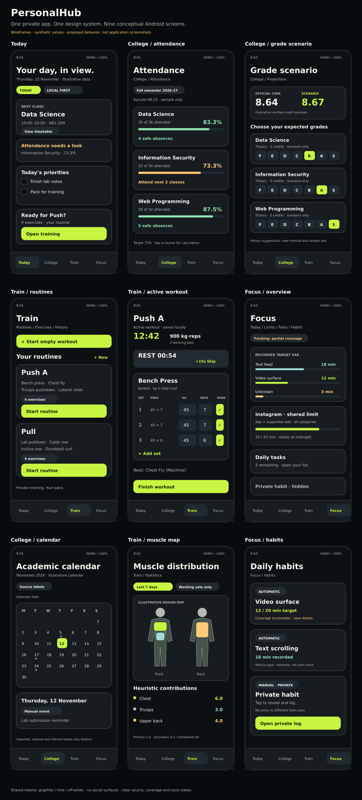
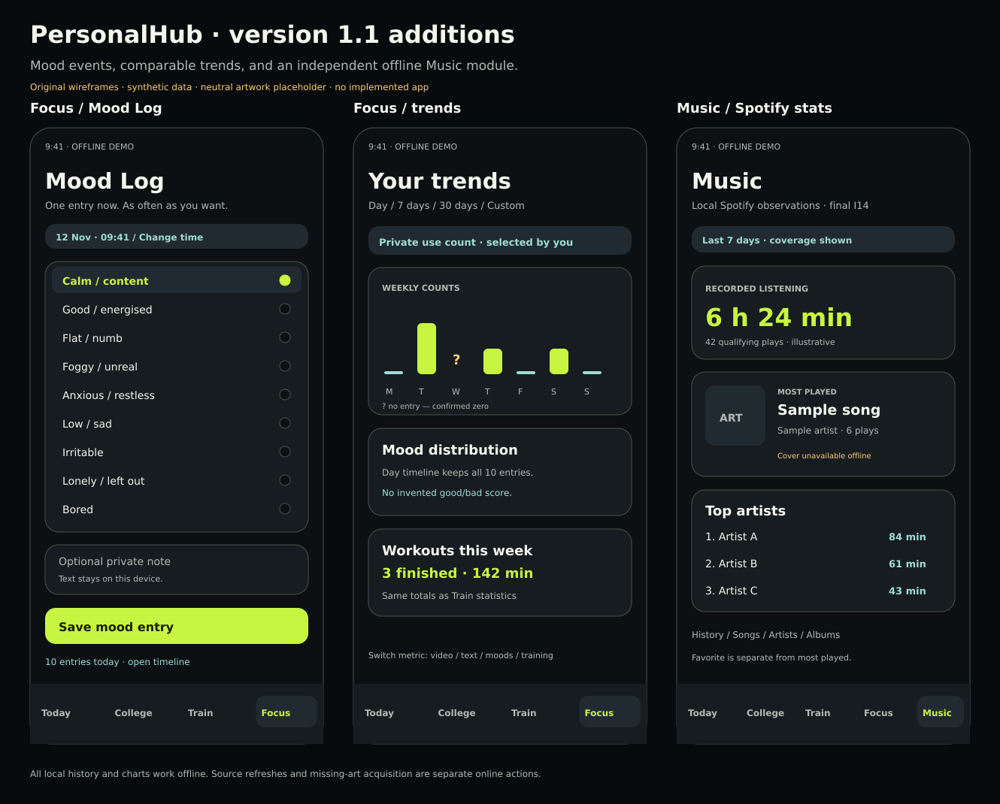

# HUB (formerly PersonalHub) — Software Requirements Specification

**Baseline:** 1.1 · **Date:** 12 November 2026 · **Status:** Ready for incremental implementation; feasibility gates remain open. Version 1.1 adds Mood Log, shared trend views, the final Spotify module and scheduled local JSON backup/export.

## 1. Purpose and interpretation

Build a fast, private Android app for one owner. It combines academic information from VIT Chennai's VTOP portal, gym routines and workout logging, and self-improvement tools. The user wants a coherent product, extensible modules, and small tested increments that another AI agent can safely continue or revert.

This document defines required behavior. `SHALL` is mandatory. `SHOULD` is a default that can change with a documented reason. Requirements marked **conditional** are desired but cannot be claimed complete before the specified platform/data validation. A failed feasibility gate narrows only the affected capability and must be recorded; it does not erase the user's desired feature.

No request is made to build a runtime AI assistant. “AI agents” refers to the development workflow. No LLM service, subscription, remote inference, or credential-processing server is needed for the baseline.

## 2. Product boundary

### 2.1 Included

- Today dashboard; shared navigation, settings, themes, and data status.
- VTOP sign-in and synchronization; semester selection, timetable, attendance, calendar, marks, grade history, GPA/CGPA scenarios and a transparent history-based estimate.
- Exercise catalog with descriptions and cleared media; routines, live workouts, rest timers, history, records, and muscle charts/body map.
- Daily tasks, manual and automatically derived habits, sensitive manual pornography-use logging, timestamped Mood Log and daily/weekly/monthly trend graphs.
- Opt-in usage tracking across Instagram, X and Reddit apps and explicitly supported browsers; text-feed and video-surface time, scroll estimates, category limits, and redirects.
- A final, separate Spotify listening-history and statistics module with local song/artist/album metadata and artwork where available.
- Fully offline operation over acquired/local data, explicit VTOP refresh, all personal records stored on device, regular `.json` backups/restore and review exports, test evidence and agent handoff records.

### 2.2 Excluded from this baseline

Multiple users, friends, sharing timetables, followers, leaderboards, subscriptions/paywalls, meal planning, recommendations of pornography, automatic pornography-content detection, website scraping through a hosted proxy, remote account dashboards, wearable synchronization, jailbreak/root controls, and unbreakable anti-tamper blocking.

Additional portal capabilities such as exam schedules are included where specified. Receipts, payments, proctor information, announcements and Moodle are catalogued as later extensions rather than automatically importing every available private field.

### 2.3 Owner and environment

The owner signs in to VTOP on the device and manages all data. The system is the only background actor. Device OS, OEM firmware, browser versions, accessibility exposure, portal markup and session policies are external dependencies. Baseline timezone is `Asia/Kolkata`; settings may change the reporting zone. English UI first. Weight defaults to kg with optional lb display. The app functions without any college or monitoring permissions for gym, tasks and manual habits.

## 3. Product structure and primary journeys

Nine original wireframes show the shared direction. The [UI guide](docs/ui_design.md) includes all thirteen supplied screenshots, their adaptation rules, detailed tokens and responsive behavior. These pictures are planning illustrations, not implemented application screenshots.

Version 1.1 adds the three supplementary concepts above. The [JSON contract](docs/data_export.md) details offline scheduled backup, selective review export and restore.

| Destination | Subsections | Main quick action |
|---|---|---|
| Today | Next class, attendance warning, today's task list, training shortcut, focus totals, sync health | Add task / resume workout |
| College | Overview, timetable, attendance, calendar, marks, grade history, projections | Refresh / choose semester |
| Train | Routines, exercises, active workout, history, statistics, body map | Start or resume workout |
| Focus | Today usage, text/video breakdown, limits, tasks, habits, Mood Log, trend graphs, tracking health | Add limit / log habit / log mood |
| Music, added in I14 | Spotify listening history, time trends, top songs/artists, album and artist details | View period / tracking status |
| Settings, via toolbar | Appearance, permissions, portal connection, privacy, backup, data deletion, about/licenses | Manage permissions |

The bottom bar is not duplicated inside a section. Today/College/Train/Focus ship first; Music registers as the fifth destination only in final increment I14. Section tabs/chips share the same visual components. An active workout survives tab changes and appears as a compact resume bar. First launch offers demo/local use, optional college connection, then contextual tracking setup. No permission wall prevents entry to unrelated features.

Primary academic journey: connect → solve portal challenge if needed → choose semester → sync → inspect timetable/attendance → review marks/history → adjust predicted grades.

Primary training journey: find exercise → build Push routine → start session → enter/complete sets → receive rest alert → finish → review history and muscle map.

Primary focus journey: enable selected monitoring capabilities → verify tracking health → inspect text/video/unknown use → configure a shared or per-source limit → reach it → leave target surface → reopening is blocked until reset or a logged override.

## 4. Shared requirements

| ID | Requirement | Observable acceptance |
|---|---|---|
| SYS-01 | SHALL provide Today/College/Train/Focus, plus the separately registered Music destination in I14, with independent navigation state and global settings. | Switching destinations and returning restores selected subpage; disabled Music does not affect other modules. |
| SYS-02 | SHALL operate fully offline over all local records: acquired college data, exercise catalog/media downloaded or bundled, routines/workouts, monitoring/limits, tasks/habits/moods, captured Spotify history/artwork, charts and JSON backup/restore. | Airplane mode completes every applicable local journey with no sign-in/subscription/server dependency; not-yet-acquired data is clearly unavailable. |
| SYS-03 | SHALL show loading, empty, content, partial, stale and error states separately. | A parser failure never appears as an empty semester or zero usage. |
| SYS-04 | SHALL support dark, light and follow-system themes using the shared design tokens. | Core screens pass visual review in both themes and at 200% font scaling. |
| SYS-05 | SHALL export/restore a documented, human-readable UTF-8 `.json` snapshot through the Android file picker, usable both for backup and review. An additional encrypted wrapper MAY be offered, but SHALL NOT replace JSON export. | Valid full snapshot round-trips offline; corrupt/unsupported/oversized or invalid imports leave current data unchanged; review subsets are labelled non-restorable if incomplete. |
| SYS-06 | SHALL support separate College/Train/Focus/Music data deletion and whole-app deletion, including owned backup files under the declared retention/deletion policy. | Deleting College removes credentials and cookies if selected without deleting workouts/listening history; whole deletion stops tracking and clears app-owned data; external copies already exported remain owner-managed. |
| SYS-07 | SHALL expose permission/tracking/sync health and recovery actions. | Revocation or service disconnection changes health to degraded and names affected features. |
| SYS-08 | SHALL preserve user changes across configuration change and process recreation. | A task edit, current workout and scenario selections restore according to their save rules. |
| SYS-09 | SHALL allow new sections through registered module entry points and summary interfaces. | A demo module can be added without imports into College, Train or Focus implementations. |
| SYS-10 | SHALL automatically create a local full `.json` snapshot after changes, with a default 24-hour schedule, configurable retention (default seven daily snapshots), and Backup now. | Last-success time, included modules, snapshot age and any failure are visible; missed runs catch up at the next eligible opportunity without requiring internet. |
| SYS-11 | SHALL distinguish full backups from selectable review exports with a date range, module/field selection, optional pseudonymization and preview. | Full snapshots include all retained personal records/settings, including moods and sensitive habit entries; review exports omit sensitive fields by default and never send data automatically. Neither includes passwords, cookies, tokens or OS grants. |
| SYS-12 | SHALL use the network only for explicit source acquisition/refresh or optional enabled metadata/media fetches; no runtime server dependence for local features. | VTOP refresh re-scrapes on owner request; offline refresh fails gracefully while retaining valid local data. Music metadata enrichment can be disabled independently; no cloud sync/telemetry is introduced. |

### 4.1 Meaning of “100% offline”

After acquisition, every stored record, calculation, graph and local action remains available without internet, including after process restart. There is no app-account login, remote licence check or expiring cloud token required to open local data. New portal data still needs a connection to VTOP; a refresh never erases a last-good snapshot on failure. Streaming Spotify itself is outside this app: local observation of already-downloaded playback is supported where Spotify exposes session signals. Unknown artwork/metadata cannot be invented while offline. The app does not download Spotify audio.

Store all structured user data in on-device databases; bundled/downloaded exercise media and permitted artwork bytes are on-device files. All items explicitly kept for offline use remain until owner deletion; they must not be silently evicted by an ordinary transient cache policy. Show storage controls and any intentionally excluded media. Scheduled backups run with Android's best-effort scheduling, not an exact midnight guarantee; expose missed/failed/permission-lost states and catch up on launch/unlock when eligible. No network constraint may be attached to local backup work.

### 4.2 JSON contract and backup policy

Use a versioned envelope containing `format`, `schemaVersion`, `exportKind`, `createdAt`, `reportingZone`, `moduleVersions`, `selection`, `coverage`, and module `data`. Full snapshots cover retained College, Training, Focus (tasks, habits, moods, usage, limits), Music after I14, and non-secret settings. Preserve stable IDs, timestamps/timezones, units, provenance, unknown/gap states and calculation versions. Derived charts can be regenerated. Backups contain retained data only, not intervals already deleted by the chosen retention policy.

For a self-contained full `.json`, include owned/permitted offline media bytes as typed base64 assets with hashes and ownership/attribution fields, or an explicit owner-selected data-only setting that records omissions. No host filesystem paths or temporary content-URI grants are considered portable media. Full snapshots may include sensitive values as requested; keep automatic files app-private by default, never upload them, and show which values are included. Review exports default to excluding credential identifiers, personal college identifiers, mood notes and the private habit unless the owner selects them. A separate local plaintext export is a deliberate reviewable file, not an automatic sharing action.

Default destination is app-private storage; offer a user-granted on-device folder for copies that survive uninstall, subject to the provider actually being local. Use a temporary file, validate completion, then atomically replace the last-good internal snapshot and rotate retention. If an external document provider cannot atomically rename, keep the internal verified snapshot authoritative, write a new external file, verify completion where supported and only then retire an older copy. No partially written file may be labelled a valid backup. Recovery uses staged validation and a cross-module restore journal; credentials are re-entered and permissions re-granted separately.

## 5. College requirements

### 5.1 Authentication and data acquisition

The inspected reference is [`therealsujitk/android-vtop-chennai`](https://github.com/therealsujitk/android-vtop-chennai) at commit `4d838ae79ef8452a7981d4284a4e319615f7d4b9`. It uses a Java Android WebView, DOM/JavaScript execution and portal requests, with interactive CAPTCHA and semester selection. Preserve this on-device authenticated approach while replacing its tightly connected UI/service arrangement. [Source details](docs/research.md#1-vtop-source-audit).

| ID | Requirement | Observable acceptance |
|---|---|---|
| COL-01 | SHALL accept Chennai VTOP credentials on device and offer an explicit remember-credentials setting. | Sign-in succeeds on the owner's phone; credentials never occur in logs, screenshots, fixtures or backup. |
| COL-02 | SHALL preserve portal session/CSRF behavior and support CAPTCHA/reCAPTCHA interaction when presented. | Invalid credentials, challenge failure, cancel, expiry and locked-account responses have distinct outcomes; failed credentials are not repeatedly retried. |
| COL-03 | SHALL perform reads through a dedicated connector and emit typed sync states. | UI observes Connecting, NeedsChallenge, ChoosingSemester, Syncing(dataset), Success, Partial or Failed without knowing DOM selectors. |
| COL-04 | SHALL discover available semesters, permit selecting current/previous semesters, and retain separate caches. | Refreshing semester B does not overwrite semester A. A disconnected account cannot reuse another account's cache. |
| COL-05 | SHALL persist only validated successful dataset snapshots transactionally with last-success timestamps and parser versions. | Simulated markup failure keeps the previous snapshot; one failed dataset yields partial sync. An explicitly validated empty result can clear that dataset. |
| COL-06 | SHALL provide manual refresh, cancellation, duplicate-refresh coalescing and conservative retry. | One active portal session/job at a time; challenge or login state waits for foreground interaction. Background refresh is best-effort only if a viable session method is established. |
| COL-07 | SHALL limit portal navigation and the native bridge to verified origins and expected data shapes. | External links open outside the authenticated bridge; untrusted redirects, SSL failures and oversized bridge messages are rejected. |

### 5.2 Academic views

| ID | Requirement | Observable acceptance |
|---|---|---|
| COL-08 | SHALL show weekly/day timetable: course, code, component, slot, time, room, faculty when available, and next class. | Theory/lab/project components and collisions render correctly; cancelled or special days are labelled only when known. |
| COL-09 | SHALL show attendance per course component with attended/held counts, portal percentage, target and calculation details. | Missing counts are unavailable; a target change recomputes safe absences/required classes without changing imported data. |
| COL-10 | SHALL provide an academic calendar with instructional days, holidays, exams, and event details/provenance. **Conditional import:** validate an actual calendar source first. | Portal-imported, owner-imported and manually entered events look distinct. If no supported source exists, manual/validated ICS input remains usable; a calendar is never inferred solely from the timetable. |
| COL-11 | SHALL show assessment marks with component, score, maximum, weight where known and last sync. | Pending marks remain pending; weighted total uses only validated grading structure and reports incompleteness. |
| COL-12 | SHALL show historical course grades, credits, semester GPA and official cumulative GPA/credits when available. | Multiple semesters, repeated attempts, pass/fail courses and withdrawn courses retain their identity and rule status. |
| COL-13 | SHALL provide a per-course grade selector and projected semester GPA / cumulative GPA. | Changing one grade changes the scenario, never an official grade. Official, scenario and estimated values are visibly labelled. |
| COL-14 | SHALL provide a history-based suggestion for this semester's grades with method, sample size and limitations. | With insufficient records the app reports insufficient history; a manual scenario remains available. No fabricated confidence percentage. |
| COL-15 | SHALL offer optional class/exam reminders using known events with user-chosen offsets. | Permission denial leaves events usable; stale schedule is identified; duplicate reminders are not created by resync. |
| COL-16 | SHOULD show exam date, time, venue/seat when available as a read-only extension of the verified exam-schedule parser. | A missing venue is blank/unavailable, not synthesized; calendar events link to their source. |

### 5.3 Academic calculation rules

**Attendance.** Use integer counts `a` attended and `h` held with `0 ≤ a ≤ h`. For `h > 0`, derived percentage is `100a/h`, while portal-reported percentage is retained separately because rounding/denominators may differ. For target fraction `t`, `0 < t < 1`:

- Classes to attend consecutively: `max(0, ceil((t*h - a)/(1 - t)))`.
- Safe future absences, if already at/above target: `max(0, floor(a/t - h))`.
- Use exact decimal/rational comparisons to avoid off-by-one at thresholds. No division when `h = 0`; show no classes yet. Targets 0%/100% require explicit boundary handling (100% cannot be recovered after any absence). “Safe” assumes every future scheduled class counts equally; the calendar does not guarantee final eligibility.

**GPA/CGPA.** Use a versioned campus/regulation policy, validated against the owner's portal/regulations. A provisional selector may show the supplied `S,A,B,C,D,E,F` scheme, but do not mark its points official without verification. General semester formula: `sum(credit_i * gradePoint_i) / sum(includedCredit_i)`. Never average semester GPAs without credits. Exclude/handle non-GPA courses, incomplete grades and repeats according to the verified policy.

For a scenario containing genuinely new credits, use `(historicalQualityPoints + projectedQualityPoints)/(historicalGpaCredits + projectedGpaCredits)`. If only rounded official CGPA is available, multiplying it by credits gives an **approximate** starting value and must be labelled. Earned credits are not automatically the GPA denominator, particularly with failures/repeats. If the denominator/rule is unknown, show projected semester GPA and mark cumulative calculation unavailable. Repeat-course replacement must adjust the earlier attempt under the verified rule, not simply add it twice.

**Prediction, version 1.** Begin with a credit-weighted mean of eligible historical numeric grade points. For each current course, use the same-course historical cohort if available, otherwise its course category with at least three eligible records, otherwise the overall history with at least five eligible records. Prefer the category label actually supported by data, not a guessed category from a course name. If fewer than five overall records exist and no supported cohort exists, require manual entry. Map the mean to the nearest permitted grade point (ties choose the lower point). Show source cohort, `n`, range of historical grade points, and editable suggestion. This is a personal historical baseline, not a guarantee of results. Do not infer relative-grading cutoffs from marks. Backtest later against a simple overall-mean baseline only when held-out semester data exists; no model-quality claim without evidence.

## 6. Training requirements

The desired interactions follow the supplied Hevy references: reusable routines, dense set rows, prior values, rest timers and muscle analytics. Social and subscription surfaces are excluded. Exercise artwork in screenshots is reference material, not a redistributable asset library.

| ID | Requirement | Observable acceptance |
|---|---|---|
| GYM-01 | SHALL have an offline catalog searchable by name/alias and filterable by equipment and muscle. | Seed at least 40 useful movements covering Push/Pull/Legs plus bodyweight; custom exercise creation works offline. |
| GYM-02 | SHALL show instructions, equipment, primary/secondary muscles and available demonstration media. | Media supports pause/replay and reduced motion; missing media has a useful static/text fallback. |
| GYM-03 | SHALL track source/license/author per asset and ship only cleared assets. | Every shipped image/video/body region graphic has a manifest entry; uncertain assets are excluded. GIF animation parity is conditional on finding licensed files, not copied from Hevy. |
| GYM-04 | SHALL create/edit/duplicate/archive routines with ordered exercises, target sets/reps/weight, rest duration and notes. | A Push routine can be built and restarted repeatedly; editing a routine does not change completed workouts. |
| GYM-05 | SHALL start an empty workout or a routine snapshot; only one active workout at a time. | Existing active session offers resume or explicit discard before a new session starts. |
| GYM-06 | SHALL log per-set weight, reps, optional RPE, duration/distance as applicable, set type and completion. | Previous values are suggestions; they are not counted until completed. Invalid negative quantities are rejected. |
| GYM-07 | SHALL allow exercise/set add/remove/reorder, notes and rest timer adjustments during a workout. | Removing a completed set requires confirmation/undo; unsaved input cannot disappear on navigation. |
| GYM-08 | SHALL autosave drafts and completed set edits, restore interrupted sessions, and confirm finish/discard. | Process death after a completed set restores it once, with no duplicate workout on repeated Finish taps. |
| GYM-09 | SHALL start a configurable rest countdown when an eligible working set is completed; allow skip/pause/extend/off. | Background/resume recomputes from a deadline rather than a decrementing UI counter; alert limits are disclosed when permissions are absent. |
| GYM-10 | SHALL show history, exercise trends, personal records, workout count, duration, reps and volume by date range. | Editing/deleting a session recomputes dependent statistics; empty chart never invents a zero-value workout. |
| GYM-11 | SHALL show front/back muscle maps and set-distribution charts for day/7d/30d/custom ranges. | Selected period controls both map and numeric list; unknown muscle mappings are separately counted. |
| GYM-12 | SHOULD support routine folders, supersets and body measurements after basic logging passes. | A superset can group exercises without losing per-set rest rules; measurements are optional and private. |

### 6.1 Training calculation rules

Completed non-warm-up working sets contribute to workout analytics. A configurable setting may include warm-ups but must label the choice. Base volume for ordinary weighted lifts is `sum(weightKg * reps)`; total system/dumbbell weight convention is stored per exercise. Bodyweight and assisted-machine movements are excluded from comparable kg-volume by default unless a documented effective-load rule is selected. Mixed units convert before aggregation, retaining entered units.

For muscle map v1, each completed working set adds `1.0` to each tagged primary muscle and `0.5` to each secondary muscle, removing overlaps between those lists. These are heuristic contributions, not measured physiological stimulus; totals across muscles may exceed total sets. Show a legend and exact numeric totals beside the image. Default heat bins: 0, >0–3, >3–6, >6–10, >10 contributions for the selected period. Optional normalization is separately labelled.

Estimated one-rep maximum uses `weight * (1 + reps/30)` only for supported positive-load sets of 1–12 reps. Label it an estimate; no 1RM for timed or assisted/bodyweight movements without a supported rule. Active workouts do not update lifetime records until finished. Finishing snapshots routine data; future template edits cannot rewrite history.

## 7. Focus and self-improvement requirements

### 7.1 Supported monitoring model

“Monitor all the time” means observe selected supported surfaces while permission and service availability permit it, with visible health and gaps. Baseline does **not** record the screen continuously. Usage access supplies package-level usage; accessibility supplies selected UI events/context where exposed. Neither is proof of attention or video playback. Detect a **video surface** separately from claiming a video was watched.

The initial source matrix must test Instagram, X and Reddit native apps and their web variants in Chrome. The next browser is Samsung Internet or Firefox according to the owner's phone. Every package/browser/version row gets supported, partial or unsupported status. Additional apps and browsers are adapters, not a global promise. Embedded browsers, custom tabs, incognito, split screen, picture-in-picture and hidden address bars require explicit tests.

| ID | Requirement | Observable acceptance |
|---|---|---|
| FOC-01 | SHALL make usage access and accessibility opt-in with a clear local-data disclosure, pause and disable controls. | Permission denial/revocation is safe; tracking cannot silently re-enable itself. |
| FOC-02 | SHALL report package foreground time and launches using supported signals and label measurement source. | Screen-off/lock and background time are excluded; overlapping sources do not double count. |
| FOC-03 | SHALL distinguish `TEXT_FEED`, `VIDEO_SURFACE`, `OTHER_TARGET` and `UNKNOWN` for supported app/browser contexts. **Conditional accuracy.** | Versioned classifiers pass the agreed labelled-session gate; low-confidence or unrecognized layouts become unknown. |
| FOC-04 | SHALL report text and video-surface time separately across native and web variants with source breakdowns. | Combined Instagram totals include app + recognized Instagram web without counting unrelated Chrome usage. |
| FOC-05 | SHALL estimate scroll activity with a declared unit and reliability. | Display deduplicated scroll bursts and, only where deltas are reliable, estimated screen lengths. Never present event count as exact posts/reels watched. |
| FOC-06 | SHALL support per-service, shared-service and text/video category daily time budgets and session limits. | Limit previews show scope, timezone, reset, used amount, included unknown behavior and remaining duration. |
| FOC-07 | SHALL evaluate enabled limits during use and whenever a target surface opens again. | Exhausted daily budget redirects on reopen until reset; state survives app process restart. |
| FOC-08 | SHALL interrupt a blocked target using supported accessibility navigation/overlay behavior. | Owner is redirected to Home or an accessible local explanation; this is labelled a redirect, not force-stop. Unrelated apps and emergency/system settings remain accessible. |
| FOC-09 | SHALL let the owner choose native-package blocking or recognized-domain blocking per target. | A recognized X page is blocked without blanket-blocking every Chrome tab; an unrecognized browser context is shown as a coverage gap. |
| FOC-10 | SHALL provide tracking health, coverage gaps, adapter version, last activity, pause state and battery guidance. | Service death/reboot/permission loss produces visible incomplete coverage; no invented backfilled text/video split. |
| FOC-11 | SHALL offer optional strict behavior with friction and logged time-limited overrides, plus an always reachable disable route. | Repeated launches remain blocked; a deliberate override expires; toggling strict mode cannot trap the owner outside settings. |
| FOC-12 | MAY offer visible temporary screen-analysis sessions if accessibility cannot classify a required surface. | New MediaProjection sessions request system consent, process locally, retain no raw frames, and stop on OS/user termination; baseline operation does not depend on this experiment. |

### 7.2 Counting and limit semantics

- A **scroll burst** groups scroll events from the same foreground target/root until a gap greater than 300 ms, with a 1,000 ms maximum burst window. A new target/window ends a burst. These are scroll operations, not item counts. Replay tests must verify flings and recycler recycling do not multiply-count the same burst.
- Where valid vertical deltas exist, estimated screen lengths = `sum(abs(scrollDeltaY))/contentViewportHeight`; ignore nested duplicate sources, programmatic animations and invalid jumps when identifiable. Without reliable deltas show burst counts only. Distances are estimates and version-specific.
- Use elapsed monotonic time within a session, UTC instants for persistence and an explicit reporting `ZoneId` for daily boundaries. Split sessions at local midnight, lock, pause, target change, permission loss and classification transitions. No overlap between category intervals. Known tracking gaps are stored as gaps, not usage.
- Video time includes foreground dwell on a detected video surface, not just swiping; text time includes reading while stationary. No event after a delay does not prove app exit; reconcile foreground state and use bounded health checks while a target is active.
- Default budgets are unset until the owner configures them. A saved zero-minute budget means block immediately. The most restrictive exhausted applicable rule wins. Time categories can share a combined service budget across native/web without double counting.
- Unknown target time counts toward the service-wide budget by default. For category-only rules the owner chooses `do not classify` (default; may permit leakage) or `count unknown toward this limit` (conservative; may block unrelated content within the target). Show this choice explicitly. No global unknown-browser blocking.
- Session limit measures one continuous target visit, ending after leaving for 60 seconds; daily budget persists across visits. First warning defaults to 80% of budget and at most one warning per rule/day. Budget changes apply immediately with an explanation. Local clock changes/reboot cannot reset already-used budget silently; reassigning reporting timezone requires a documented boundary policy and preview.
- Reopen detection is event-driven; aim for redirect p95 within 1 second of an observable supported target event on the owner's phone. It is not zero-latency or tamper-proof. Browser domain detection parses the exact host against an allowlist (`instagram.com`, `x.com`, `twitter.com`, `reddit.com`, explicit subdomains), never a substring that could match `reddit.com.example.org`.

### 7.3 Tasks and habits

| ID | Requirement | Observable acceptance |
|---|---|---|
| HAB-01 | SHALL support daily tasks: create/edit/complete/delete, priority, optional due time, recurrence and carry-forward choice. | A recurring task has distinct daily occurrences; completing yesterday does not complete tomorrow. Deletion has undo or confirmation. |
| HAB-02 | SHALL support manual habits with count, duration or yes/no goals, notes, history, reminders and editable past entries. | Duplicate taps are reversible; missed/unknown differs from an explicit zero. |
| HAB-03 | SHALL provide automatic text/video scrolling habits derived from the canonical usage aggregates. | Derived values update with corrections/reclassification and carry coverage; they are not duplicated as new manual events each refresh. |
| HAB-04 | SHALL include an optional private manually logged pornography-use habit, increment/decrement, backdating and undo. | A tap adds one owner-defined occurrence, not one automatically detected event; label is editable, no unsolicited content is shown. |
| HAB-05 | SHALL distinguish goal directions: increase, reduce or abstain, and show trends without shaming. | Reduction goals consider values at/below target successful only on a complete/explicitly confirmed day; unknown day is not a streak success. |
| HAB-06 | SHALL keep sensitive habit/mood values hidden from notifications, Today cards and review exports by default; full local backups include their retained records under SYS-11. | Owner can explicitly choose visibility/review-export fields; app/Focus lock is available with device credential fallback. |
| HAB-07 | SHALL offer Mood Log with exactly the nine baseline labels/emojis below and one selected mood per timestamped entry, at any time and with no daily entry cap. | Ten entries in one day persist as ten distinct events; add/edit/delete/undo/backdate and optional notes work offline; editing does not overwrite other entries. |
| HAB-08 | SHALL provide Today/day, last 7 days, last 30 days/calendar month, and custom trend views for moods, private manual use counts, Reels/video/text usage and workouts. | Charts use the selected local date/zone, metric and source; manual missing days differ from confirmed zero; usage gaps are visible; workout totals match Training's public summary API. |
| HAB-09 | SHALL graph moods as timestamped categorical events and category frequencies/distribution, with optional per-day dominant category plus counts. | Day timeline exposes all entries and exact times; week/month can drill into a day. Moods are not assigned an invented good/bad numeric score or averaged as if ordered quantities. |

Default focus habit cards: video-surface minutes, text-feed minutes, and private manual use count. Show today/7d/30d, daily goals and change from the preceding comparable period. “No entry” is unknown; an explicit “none today” confirms zero. Auto-captured days show coverage separately from the measured number. Habit reminders use neutral wording.

### 7.4 Mood vocabulary and trend presentation

| Stable code | Emoji | Exact displayed label |
|---|---|---|
| `calm_content` | 😌 | Calm / content |
| `good_energised` | ⚡ | Good / energised |
| `flat_numb` | 😐 | Flat / numb |
| `foggy_unreal` | 🌫️ | Foggy / unreal |
| `anxious_restless` | 😟 | Anxious / restless |
| `low_sad` | 😔 | Low / sad |
| `irritable` | 😠 | Irritable |
| `lonely_left_out` | 🫥 | Lonely / left out |
| `bored` | 🥱 | Bored |

Store a stable code separately from localized label/emoji. One entry records one selected category, occurrence timestamp, original timezone, creation/update timestamp, optional note and revision. Same-millisecond entries still have separate UUIDs. Log time defaults to now; past-time editing is explicit, future occurrence times are rejected. Notes are optional and private. Large fonts/TalkBack use text labels rather than relying on emoji rendering.

Day mood graph is a categorical time scatter/swimlane with timestamps; week/month uses per-category counts or stacked daily distributions and an event-list drilldown. Do not draw a slope through categories implying an emotional severity scale. If showing a dominant category, ties are labelled mixed and counts remain accessible. No mood entry means no recorded mood, not neutral/calm. Ten logs today mean ten observations, not ten better/worse days. Display sampling frequency; daily-normalized distributions may be offered separately so frequently logged days do not silently dominate a comparison. No diagnosis or causal claim is generated from mood, pornography, scrolling or training data.

Private manual use graph shows daily occurrence bars, week/month totals and change from the previous equal-length period. Reels/video graph shows recorded minutes (native/web service breakdown where supported) and optional estimated scroll bursts; it never labels all video time as specifically Instagram Reels. Workout graph shows finished-workout counts and selectable duration, completed working sets or supported volume. Units stay distinct; incomplete/unknown days are visibly marked. Focus receives read-only Training summary contributions through app composition, never via Training's DAO.

## 7A. Music — Spotify history and statistics (final module, I14)

Music is independent of screen monitoring. Preferred acquisition is an explicitly enabled Android notification-listener/media-session adapter filtered to Spotify, observing metadata/playback-state changes locally, including background/locked-screen playback where available. This requires its own permission and physical-device probe in I14; screen permission is not automatically permission to inspect notifications. No microphone, audio recording, OCR loop or Spotify-password collection is required.

| ID | Requirement | Observable acceptance |
|---|---|---|
| MUS-01 | SHALL implement Music as an isolated optional module added only in final increment I14, with its own repository, data store, health and controls. | Disabling or deleting Music has no effect on College, Train or Focus and does not require screen-monitoring permission. |
| MUS-02 | SHALL capture observable Spotify track sessions from opt-in local playback metadata/state, starting when tracking is enabled. | Background, lock-screen and downloaded-song offline cases are tested; stopping permission/service creates a gap. Past unobserved plays and other-device listening are not invented. |
| MUS-03 | SHALL store title, artist credit(s), album, source IDs where exposed, timestamps, observed playback segments, track duration when known and measurement provenance. | Missing/ambiguous fields remain null or unresolved; same-title different tracks do not merge solely by name. Podcasts/ads/unknown content are separated from song rankings. |
| MUS-04 | SHALL show album/track artwork and artist pictures when lawfully obtainable, retained locally for offline access. | Capture exposed artwork or optionally fetch permitted metadata/art when online; offline/missing pictures use labelled placeholders or owner-provided local images. Album art is not falsely labelled as an artist portrait. |
| MUS-05 | SHALL estimate listened duration from observed playing intervals; exclude paused/buffering time and seek jumps, handle repeats/skips and deduplicate metadata callbacks. | Playback-position jumps do not add unlistened seconds; repeated callbacks do not create duplicate listens; uncertain gaps are labelled, never filled with full track length. |
| MUS-06 | SHALL show chronological listening history with date/time, songs/artists/albums, observed duration, artwork and coverage status, fully offline. | Search/filter/day drilldown works after restart in airplane mode; timestamp/identity corrections preserve provenance. |
| MUS-07 | SHALL show daily/weekly/monthly/custom listening minutes, qualifying plays, unique songs/artists, top songs/artists and change over time. | Rankings derive from local captured records, show range/metric/coverage and recompute after corrections/deletion; no claim of matching Spotify Wrapped's private methodology. |
| MUS-08 | SHALL show “Most played this week” and other periods, plus a separate optional manually marked Favorite. | Most played is defined by selected local ranking metric, not proof of preference or Spotify Liked Songs; ties use documented ordering. |
| MUS-09 | SHALL preserve local history/stats without Spotify API connectivity; optional enrichment uses an explicit owner setting and official available access where needed. | Disabled/offline/expired optional API access does not disable local capture or records; no embedded secret or compulsory server. Imported history is labelled and reconciled without duplicates. |
| MUS-10 | SHALL participate in scheduled JSON backups, review exports, restore, retention and module-specific deletion. | Offline round-trip preserves listening segments, identities, permitted selected artwork and unresolved/gap states; secrets/grants are excluded. |

### 7A.1 Listening-statistic semantics

Store every observed playback attempt, including short skips, but use a separate documented qualifying-play rule: observed playing time of at least `min(30 seconds, 50% of known track duration)`; if duration is unknown require 30 seconds. A known zero/invalid duration is unresolved rather than a zero-threshold play. This is PersonalHub's rule, not Spotify's accounting standard. Repeated playing segments from a pause/resume belong to the same attempt unless a validated track restart/transition creates a new one. Same-track repeat detection requires position-transition evidence; uncertain repeats stay flagged.

Default song rank: qualifying plays descending, then observed listening seconds descending, then stable track key. Artist rank includes each explicitly credited artist once per qualifying play; duration is divided equally among known credited artists in the default additive chart, with the attribution method labelled. If only one combined artist string is exposed, keep it as an unresolved credit string rather than splitting by commas or guessing identities. Unique artist totals distinguish resolved entities from unresolved credit strings. All attempts can contribute actual observed time even when they do not qualify as a play.

Time means local observed playback duration, not proof of audibility, volume, headphones or human attention. No guarantee of complete lifetime/all-device Spotify history is made from a local listener. Optional official API/review-file import can supplement history only after checking current access and data semantics; it cannot manufacture pause/seek intervals or exact listened seconds. Images/metadata availability and permitted retention must be verified during I14; missing images do not block local logging/statistics. The app does not copy Spotify audio files or become an audio player.

## 8. Non-functional requirements

These are engineering budgets to measure, not current measurements. Increment 0 records the reference phone and toolchain; targets may change by a reasoned decision record before implementation, never by silently removing a failed gate.

| ID | Requirement / target | Verification |
|---|---|---|
| NFR-01 | Native Kotlin/Compose; IO/large calculations off main thread; no permanent WebView or continuous OCR in ordinary use. | Architecture review and profiling. |
| NFR-02 | Local-first, no telemetry/ads, no personal-data backend; secrets encrypted with platform-managed keys; sensitive data excluded from OS/cloud backups. | Network audit, backup rules, storage/log inspection. |
| NFR-03 | On reference phone, release cold start p95 ≤2.5 s; local common actions p95 ≤150 ms, excluding media/network. | Macrobenchmark with warm/cold conditions recorded, at least 20 runs. |
| NFR-04 | Routine scrolling should have <5% slow/janky frames under an agreed recorded test; no ANRs in release walkthrough. | Frame metrics and device trace, with refresh rate and method recorded. |
| NFR-05 | Base APK target ≤40 MB excluding downloadable media; transient media cache default 150 MB with clear/size controls. Explicitly downloaded/pinned offline media and retained Music artwork have separate visible storage controls and are not silently evicted. | Artifact size report; lazy load/pause offscreen media. |
| NFR-06 | Monitoring battery overhead target ≤5 percentage points over an 8-hour matched baseline scenario, repeated at least three times. | Same phone/settings/workload; report medians, variance, temperature and monitoring mode. Always-on vision is outside this budget. |
| NFR-07 | Native/web classifiers target precision and recall ≥90% per class on supported versions, at least 30 labelled segments per class/surface, plus full coverage reporting. | Confusion matrix including unknown; rejected/unknown true segments lower end-to-end recall. Document insufficient samples rather than claim success. |
| NFR-08 | Persist workout/task changes within 1 s of committed UI action; no data loss at acknowledged save boundaries. | Process-death tests and transactions. |
| NFR-09 | Android minimum API 29 provisional; test minimum, current stable and owner's actual OS, physical-device checks for monitoring. | Device matrix and capability report. |
| NFR-10 | Touch targets ≥48 dp; TalkBack labels; contrast ≥4.5:1 normal text, ≥3:1 large text and essential graphical controls; no color-only meaning. | Accessibility scanner plus manual TalkBack/font-scale review. |
| NFR-11 | Module boundaries, versioned schemas, deterministic pure domain logic, structured redacted errors. | Dependency/lint review, contract tests and migration tests. |
| NFR-12 | Every meaningful increment has linked test evidence, updated code map, changes/pending work, migration and rollback notes. | Handoff review before increment completion. |

## 9. Permissions and sensitive data

| Capability | Permission / mechanism | Denied/revoked fallback |
|---|---|---|
| Portal sync/media download | INTERNET; ordinary network state | Cached data; retry when online |
| Usage totals | Usage-access special settings grant | Manual habits/tasks continue; package totals unavailable |
| Content context and redirects | User-enabled AccessibilityService | No category tracking/enforcement; explicitly report disabled |
| Alerts/reminders | Notification permission where required | In-app countdown/status, with background alert reliability warning |
| App/Focus lock | Android biometric/device credential prompt | Device credential fallback; reset behavior documented |
| Backup/import | Storage Access Framework file picker | Internal data unaffected; no broad storage permission |
| Spotify capture | User-enabled notification access + available media-session metadata/state | Music history stays readable; new capture unavailable with a visible gap; Focus permission is separate |
| Optional vision experiment | MediaProjection session consent + correctly declared foreground service type | No vision; accessibility/unknown fallback |
| Precise rest alert, if needed | Evaluate exact-alarm eligibility/special access only after testing | Display correct deadline; disclose delayed background alert possibility |

Do not request microphone, camera, contacts, location, root, device administration or all-files access for these features. An accessibility overlay may be used within service capabilities; request general overlay access only if a separately justified implementation needs it. Do not automate changing Android settings or preventing service disable/uninstall.

Credentials and CSRF/cookies are never uploaded to development agents. All live sign-in occurs on the owner's device. Production diagnostics contain dataset/status codes, duration and parser version, never portal HTML, personal grade rows, browser text, URLs with query strings, images, usernames or credentials. Accessibility processing is package-allowlisted, avoids password fields and discards transient text as soon as context is classified. The Music listener drops non-Spotify notification content immediately and retains only needed structured playback data. No screenshots/keylogging archive. Personal JSON exports are owner-controlled data files, separate from redacted diagnostics.

## 9A. Release 1.1 additions (owner request, 14 November 2026)

The app is renamed **HUB** everywhere the owner sees it (launcher label, screens, notifications, release assets, repository). The Android application ID `dev.personalhub` and the signing key stay unchanged so updates keep all data and permissions.

| ID | Requirement | Acceptance |
|---|---|---|
| NAV-01 | Going to a different sub-page (forward or Back) SHALL start that page at its top. | Scroll Marks, press Back: College home shows from the top. |
| NAV-02 | Tapping the bottom-bar destination already selected SHALL return to that destination's home page, scrolled to the top. | From College → Exams, tapping College opens College home. |
| GYM-13 | Workout history SHALL show compact cards (title, date/time, duration, sets, reps, volume); tapping one SHALL open a pop-up with every exercise (small square photo as bullet) and every completed set. | No exercise lists on the history page; pop-up lists all sets. |
| GYM-14 | Finished workouts SHALL be editable (name, duration, exercises, sets, done state) as a draft saved only on Save. | Edited values replace the stored workout; Cancel changes nothing. |
| GYM-15 | History SHALL start with a last-7-days panel: day strip, front/back muscle map (REF-08), workouts, volume and PR count. | Panel totals equal the sum of the week's finished workouts. |
| GYM-16 | A lift PR is a top working set that strictly beats the best of all earlier workouts for that exercise (kg for weighted, reps for bodyweight, seconds for timed); the first time an exercise is logged is the baseline, not a PR. PRs SHALL show a 🥇 beside the set and on the workout card. | Unit test: equal or lower lifts, warm-ups, unfinished sets and active sessions never count. |
| COL-14 | Exams SHALL show seat number and seat position (e.g. R1C4) as bubbles beside the course code, plus exam time, reporting time, venue and session; the date appears only in the date badge. | Parser reads "Seat Location" or any cell shaped like R<n>C<n>. |
| COL-15 | Grade History SHALL show the semester GPA exactly as VTOP prints it on Grade View; the app SHALL NOT compute a semester GPA. Missing values show "—". | Parser test: "GPA : 8.61" read, CGPA ignored. |
| COL-16 | Grade History course cards SHALL be compact (title, code/type/credits in small bubbles, grade); component marks, total and grade ranges open in a pop-up on tap. | Code, type and credits fit on one line on a 360 dp screen. |
| COL-17 | Today SHALL state the kind of day from the academic calendar: holiday ("Today is a holiday! Enjoy your day" + a random fun fact from a bundled list of 500), no classes, next class, or classes done. From 7 pm, tomorrow's first class shows only if tomorrow is a working day. | Unit tests cover holiday, working day, after last class, evening before working/holiday/free day. |
| NOT-01 | Settings → Notifications SHALL offer per-kind switches: next class, new marks, rest finished, task due times, daily habit check-in. | Each switch independently enables/disables its notification. |
| NOT-02 | Next-class alerts SHALL fire 10 minutes before a class, or immediately when a still-running previous class ends if that is later; holidays are skipped. | Unit test for normal, back-to-back and holiday cases. |
| NOT-03 | A sync that finds new or changed marks for the same semester SHALL add an entry to the in-app bell inbox (badge with unread count beside Settings) and, if enabled, post a notification. The first sync of a semester never floods. | Unit test for new/changed/first-sync/semester change. |
| HAB-08 | Google Tasks SHALL collapse to a small sync icon in the Tasks header once connected or dismissed; tap syncs (or reopens setup), long-press shows details; Settings SHALL always offer connect/disconnect and setup help. | Card hidden after connect or ✕; icon spins while syncing. |
| UPD-01 | HUB SHALL check the public GitHub releases of the project (anonymous request, no personal data) every few hours and on demand, with an owner switch to turn automatic updates off. | Settings → App updates shows status and Check now. |
| UPD-02 | An update SHALL be installed only if it is an APK for the same package, with a higher version code and the same signing certificate; anything else is discarded. | Unit test for version ordering and repository-only asset URLs. |
| UPD-03 | Installation SHALL use the system PackageInstaller session API, preserving app data and granted permissions (notifications, accessibility, overlay, Google sign-in). After the owner's one-time "install unknown apps" approval, updates SHALL need no taps (Android 12+), and on Android 14+ SHALL wait until HUB is not in the foreground. | Device check: v1.1 → next version updates while HUB is closed; data and permissions remain. |

## 10. Completion and change control

An increment is complete only when its acceptance checks pass, relevant existing features remain usable, documentation matches code, and device-only claims have actual device evidence. A skipped test stays “not run”; no agent may equate generated code or an emulator preview with verified live scraping or blocking.

Every requirement maps to an increment and validation family in [verification.md](docs/verification.md). When discovery changes a requirement, retain the original intent, record the new capability boundary in an ADR, update affected IDs/tasks/tests together, and explain the consequence. Adding a new feature must not bypass earlier failing dependent gates. Independent modules may progress while a device-only gate remains pending, but must not present that gated capability as shipped.

See [increments.md](docs/increments.md) for the build/test/add loop and [project_progress.md](project_progress.md) for the actual current state.
