# Unified UI design brief

The supplied screenshots are interaction and visual references. They are not screens from this project and do not establish reuse rights for their branding, exercise artwork or anatomy images. The proposed design below uses original layout wireframes and synthetic values.

## 1. Visual direction

Use a dark graphite foundation with a lime primary accent, off-white typography and clearly outlined rounded cards. Preserve the academic references' bold titles, pill labels, grade selectors, compact calendar and expressive character; use Hevy's generous hierarchy, dense set-entry grid and reusable routine flow. All sections share the same card radii, fonts, spacing, buttons, navigation and semantic colors. Train does not retain a separate blue brand while College uses lime.

Light mode uses warm ivory rather than pure white, dark ink, subtle borders, and a deeper green action color with accessible on-color text. A gentle dotted motif may appear on onboarding or empty states, never behind a dense table or body text. Restrained offset shadows can appear in light mode; dark mode relies on tonal elevation/borders, not invisible black shadows. Do not import the VITals name/logo/doodles or Hevy branding as app identity.

## 2. Shared tokens

| Token | Dark | Light | Use |
|---|---|---|---|
| Background | `#0D1013` | `#FAFAF0` | Screen canvas |
| Surface | `#171C21` | `#FFFFFF` | Cards and sheets |
| Raised surface | `#222A31` | `#EEF1E8` | Fields, selected backgrounds |
| Text primary | `#F4F6EE` | `#111713` | Titles/content |
| Text secondary | `#B1BBB4` | `#505D54` | Supporting labels |
| Border | `#46534A` | `#68776B` | Essential outlines; refine against component contrast |
| Primary / on primary | `#C8F542` / `#172000` | `#315C00` / `#FFFFFF` | Main actions and selected state |
| Positive | `#8DE2AD` | `#19633C` | Healthy status, with text/icon |
| Warning | `#FFCB77` | `#755000` | Attendance/limit warning |
| Error | `#FFA3A3` | `#A52222` | Failure/destructive confirmation |
| Info | `#9EDDD5` | `#1F6660` | Provenance and neutral context |

Token pairs are candidates; contrast-test actual combinations in I01, including outline/selected/unselected states. Charts need labelled markers/patterns and accessible tabular alternatives. Disable automatic dynamic color initially so supplied-design consistency remains testable; optional dynamic color can come later.

Typography: platform sans first (no download needed), bold/extra-bold headings, medium controls, tabular numerals for GPA/weights/timers. Optional bundled licensed display font only after reviewing text at large font scales. Roles: display 32sp/38, section title 24sp/30, card title 18sp/24, body 16sp/24, label 13sp/18. Do not force fixed text heights. Spacing scale: 4/8/12/16/24/32dp; screen padding 20dp; cards 16–20dp radius; fields 12dp; control targets ≥48dp; standard icon 24dp. Grade selector cells may wrap/scroll with labels rather than shrinking below touch targets.

## 3. Navigation and screen inventory

| Screen ID | Screen and key content | Primary action / state details |
|---|---|---|
| ONB-01 | Welcome: app purpose/privacy, initial sections plus Music preview when enabled | Continue; skip college connection |
| ONB-02 | College connection: campus badge, username/password, remember option, secure-local explanation | Connect; progress/challenge/failure distinct |
| ONB-03 | Contextual monitoring explanation, capability cards | Enable selected access or Later; not required during first app launch |
| TDY-01 | Today: date, next class, one attendance warning, tasks, resume/start training, focus summary | Add task / resume; each card opens owning module |
| COL-01 | Academic overview: semester switch, official GPA/CGPA, sync status and next class | Refresh; stale/partial badge opens dataset details |
| COL-02 | Timetable: day/week, time rail and course blocks; selected meeting sheet | Day mode for narrow/large text; no friends/code-sharing controls |
| COL-03 | Attendance list: percentage, counts, target gap, component labels | Change target; detail explains safe/required classes |
| COL-04 | Calendar: month, type legend, selected day, source-labelled events | Add personal event / navigate month; month grid degrades to agenda at large text |
| COL-05 | Marks: course cards + assessment rows, pending weight | Course detail; no missing-as-zero subtotal |
| COL-06 | Grade history: semester accordion/list, attempts, official summaries | Filter semester; show verified rules |
| COL-07 | GPA scenario: Official / Scenario / History estimate, grade selectors and credits | Reset scenario / view method; no scenario value in official card |
| TRN-01 | Training overview: routines, empty-workout action, recent sessions | Start routine / resume active workout |
| TRN-02 | Exercise catalog: search + muscle/equipment filters | Add custom / open detail |
| TRN-03 | Exercise detail: cleared media, primary/secondary muscles, How to/History/Stats | Add to routine; pause/reduce motion |
| TRN-04 | Routine editor: ordered exercises and target sets, notes/rest | Save; validate and allow reorder |
| TRN-05 | Active workout: elapsed time, summary, previous/load/reps/done rows, rest banner | Finish; sticky resume/finish controls avoid keyboard overlap |
| TRN-06 | Workout summary/history: actual completed sets, metrics, notes | Edit / duplicate as routine / delete with undo |
| TRN-07 | Statistics: shared range, Duration/Volume/Reps chips, charts, body map/list | Select range and muscle; unknown/unmapped explained |
| FOC-01 | Focus Today: text/video/unknown time, budget bars, coverage status | Configure limits / tracking health |
| FOC-02 | Usage detail: per-service native/web split, category totals, source limitations | Choose period/source; no exact-post claim |
| FOC-03 | Limit editor: scope, daily/session, minutes, unknown policy, reset and strict options | Save with human-readable rule preview |
| FOC-04 | Block explanation: exhausted scope, reset time, override if enabled | Leave / deliberate temporary override; disable reachable |
| FOC-05 | Tasks: today/upcoming, priorities and complete controls | Add/edit; recurring occurrence dates explicit |
| FOC-06 | Habits: goal direction, manual/automatic badges, 7d grid, explicit none today | Log/undo; sensitive habit masked by default |
| FOC-07 | Tracking health: permission/service state, supported surfaces and gaps | Open settings/pause; unsupported version explanation |
| FOC-08 | Mood Log: nine emoji/label choices, occurrence time, optional private note, recent events | Save one event; unlimited same-day entries, edit/delete/undo |
| FOC-09 | Trends: day/7d/30d/calendar month/custom, mood timeline/distribution and habit/workout metric selector | Exact event/metric drilldown; category/unknown/missing legend |
| MUS-UI-01 | Music: recorded listening minutes, period, most-played song, song/artist tabs and chart | Open local history; health/coverage always visible |
| MUS-UI-02 | Music song/artist/album detail and history: cover/portrait role, timestamp, observed duration, plays | Favorite toggle is separate from derived ranking; unavailable image placeholder |
| SET-01 | Settings: appearance, connection, permissions, privacy/lock, local JSON backup/export/restore/delete, about | Last backup/schedule/location/retention; full vs review preview; destructive scope confirmation |

Back navigation from workout asks only when discarding; normal back preserves draft and shows resume bar. Reordering controls need accessible up/down alternatives. The keyboard never covers the active set's completion button. Charts expose a text/table alternative; muscle selection reads its value to TalkBack. Profile images/followers/share/pro badges in Hevy references are omitted.

## 4. Original proposed screen board

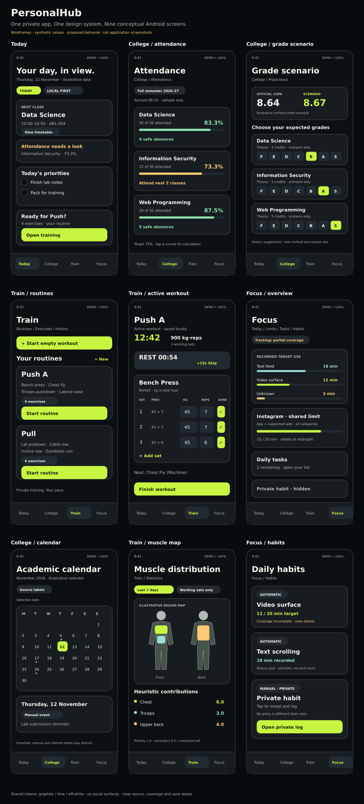

This board illustrates Today, College attendance, GPA scenario, Train routines, active workout, Focus overview, academic calendar, muscle map and habits. It is a visual specification, not an APK screenshot or a claim of working integration. Numbers and routine names are dummy values. Responsive behavior, labels and states in this guide take precedence over compressed wireframe text. Detailed calendar/body-map design comes from the rules below and the supplied references.

### Academic adaptation

Keep bold section headers, pill semester/course-component/credit labels and the compact grade selector from REF-01–05. Dark calendar: graphite cells, lime selected-day outline, mint instructional badge, amber holiday/weekend hint, neutral day labels. Do not make every weekend a holiday automatically. A selected-day detail card carries event type and provenance. Timetable blocks use lightly tinted accent surfaces with readable course/room text, not tiny unlabeled colored capsules at production scale. The week grid scrolls horizontally; day agenda is the accessibility fallback.

### Training adaptation

Routine cards have title, two-line exercise summary and full-width Start button. Active workout uses a compact grid: SET / PREVIOUS / KG or selected unit / REPS / DONE. Previous entries are muted suggestions, not completed sets. Completed rows have a check and visible saved feedback, not only a color change. Rest banner uses a large readable deadline countdown with +15s/Skip controls. A persistent Finish action remains reachable.

Body map: original/licensed front/back flat vector regions linked to canonical muscle IDs, not a mandatory photorealistic Hevy anatomy copy. Selected date range sits above it. A legend and muscle list show numeric heuristic contributions. Zero means no logged qualifying sets, not a medical claim about muscles being unworked. Missing mappings are separate.

### Focus adaptation

Use separate text-feed, video-surface and unknown bars with numbers. Category colors are consistent in charts and habit cards. Tracking health is always one tap away. For partial coverage use “18 min recorded · coverage incomplete,” never “only 18 min used.” Limit cards show the full scope, e.g. “Instagram app + supported web · all categories · 20 min/day.” Private manual habit is initially “Private habit · hidden,” with a deliberate reveal/log flow.

## 5. Original screenshot index and how to use it

The full manifest includes hashes and original names. Keep reference files in docs/assets only, out of the APK. REF-10 is a duplicate dashboard screenshot retained for completeness.

| ID / file | Observed design | Adaptation / exclusion |
|---|---|---|
| REF-01 `01_academic_welcome.png` | Ivory/lime welcome, bold title, outlined brand tile | Visual rhythm only; original app identity, no copied logo |
| REF-02 `02_academic_signin.png` | Strong form borders, lime action | On-device Chennai connection; replace “only Vellore” wording |
| REF-03 `03_academic_schedule.png` | Week grid plus friends | Keep week/day timetable, remove friends and timetable-code sharing |
| REF-04 `04_academic_calendar.png` | Month grid and instructional-day detail | Shared dark/light calendar + labelled sources |
| REF-05 `05_academic_cgpa.png` | Current/expected values and grade buttons | Clearly separate official/scenario/history estimate |
| REF-06 `06_exercise_demo_reference.png` | Lat-pulldown anatomy demonstration | Style/use-case reference only; find cleared replacement |
| REF-07 `07_training_statistics_menu.png` | Statistics categories | Keep useful analytics; remove pro/leaderboard UI |
| REF-08 `08_training_bodymap.png` | Date row and front/back anatomy | Selectable ranges, original/licensed map, accessible list |
| REF-09 `09_training_dashboard.png` | Metrics, chart and shortcuts | Private training overview with same shared cards |
| REF-10 `10_training_dashboard_duplicate.png` | Same dashboard | Duplicate of REF-09 by content hash |
| REF-11 `11_training_exercise_detail.png` | Demo, muscle labels and history chart | Cleared media and Summary/History/How to tabs; no leaderboard |
| REF-12 `12_training_log.png` | Set grid, previous values, rest/note controls | Core active-workout interaction |
| REF-13 `13_training_routines.png` | Named reusable routines and Start buttons | Core routine list; no pro/explore-social assumptions |

### Academic references

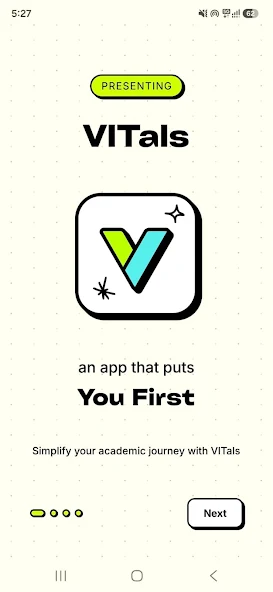
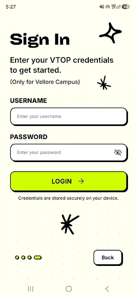
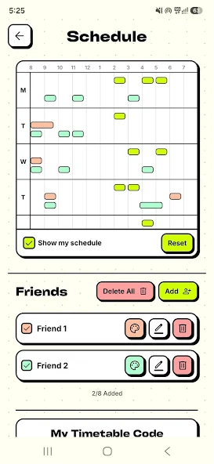
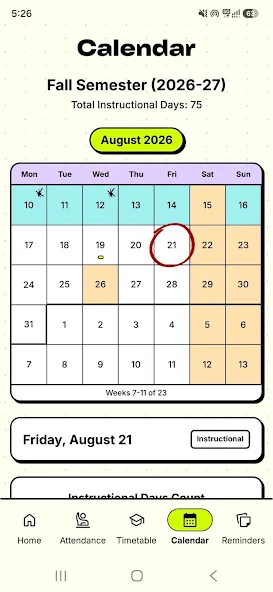
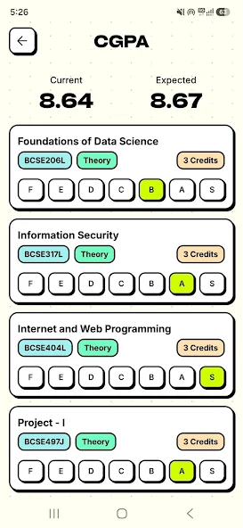

### Training references

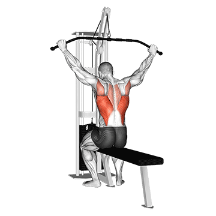
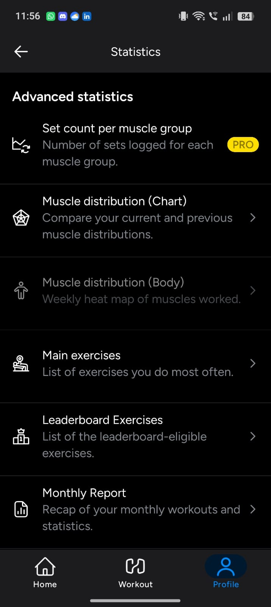
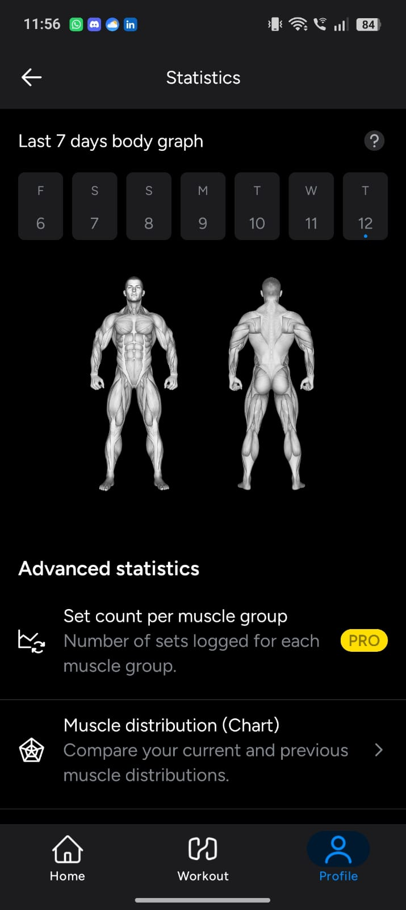
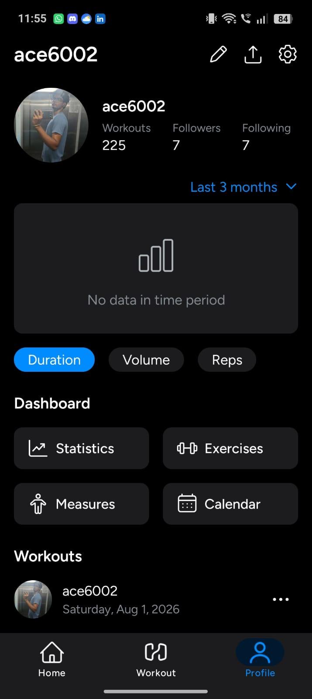

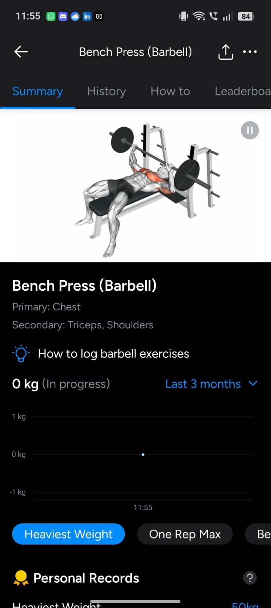
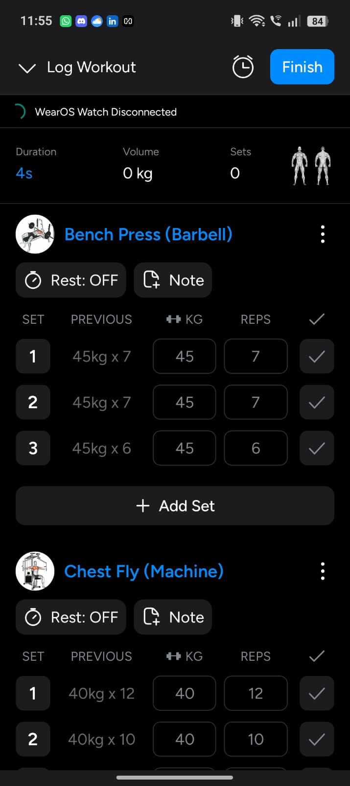
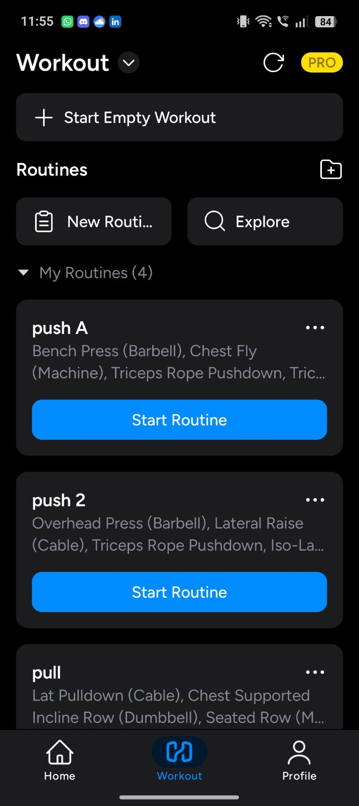

## 6. UI review checklist per increment

Use synthetic data and inspect light/dark, 360dp and 412dp widths, landscape, 200% font scale, TalkBack and keyboard-open states. Confirm loading/empty/stale/error/permission-denied variants. Check one-handed primary actions, target sizes, contrast, persistent navigation and no duplicated bars. Charts/body map require exact accompanying values. No social/profile/paywall artifacts should survive from references. Store actual rendered screen evidence with build hash once screens exist.

## 7. Version 1.1 additional screens

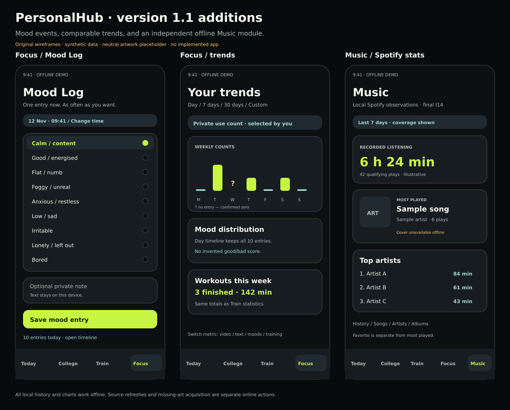

The original nine-screen board remains a reference for the initial app. This supplementary board adds three concepts using the same tokens. Music registers a fifth bottom destination only at I14; earlier screens keep four. Mood choices use the exact emoji/label table in SRS, wrapping to single-column rows at large text sizes. Mood logging does not replace or complete a daily habit: every Save appends a timestamped event unless editing a specific existing entry.

Day timeline: category lanes/events along clock time with a readable event list. Week/month: stacked distributions/counts with day drilldown and sampling denominator. No artificial low-to-high mood line. Shared trends have a clear source/metric picker (private manual count, video/text minutes, workout count/duration/sets/volume), visible units, incomplete-day markers and previous comparable period. Private details reveal only through an explicit choice.

Music has history and stats day/week/month/custom chips, artwork tiles with text fallbacks, distinct artist-portrait versus album-cover roles, local observed-time charts, top-song/top-artist lists and most-played-this-week. Artist/photo availability is conditional; missing data stays a labelled placeholder. Any Spotify-source artwork must follow current applicable attribution/link/display/retention rules; original wireframes use neutral placeholder art, not copied content. An explicit manual Favorite action is not conflated with ranked most-played data.

Backup UI: show last successful JSON, next best-effort schedule, dirty state, seven-snapshot retention, local location, size and Backup now. Full backup preview lists included sensitive records; Review export defaults to scoped fields and redaction. No Send/upload action is implied. Offline banners describe source refresh availability only; they never disable local charts/actions.
