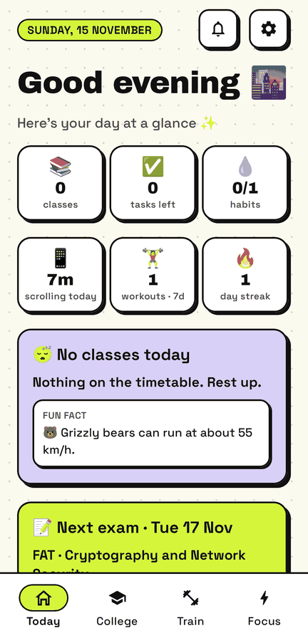
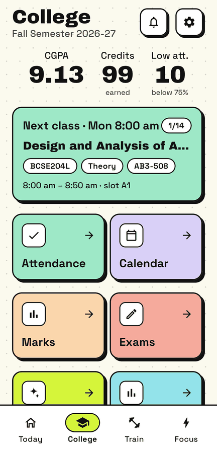
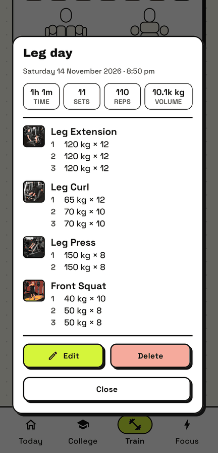
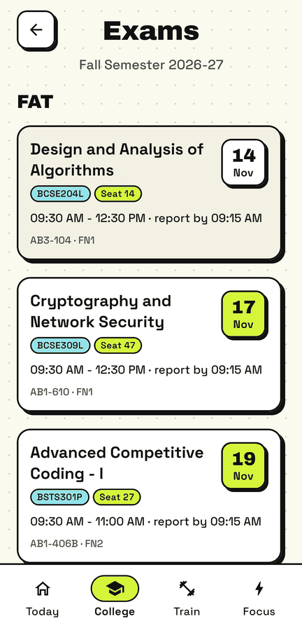
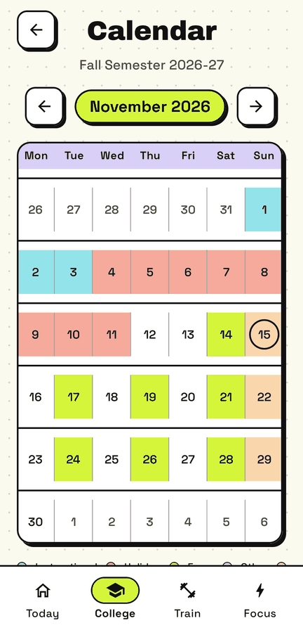
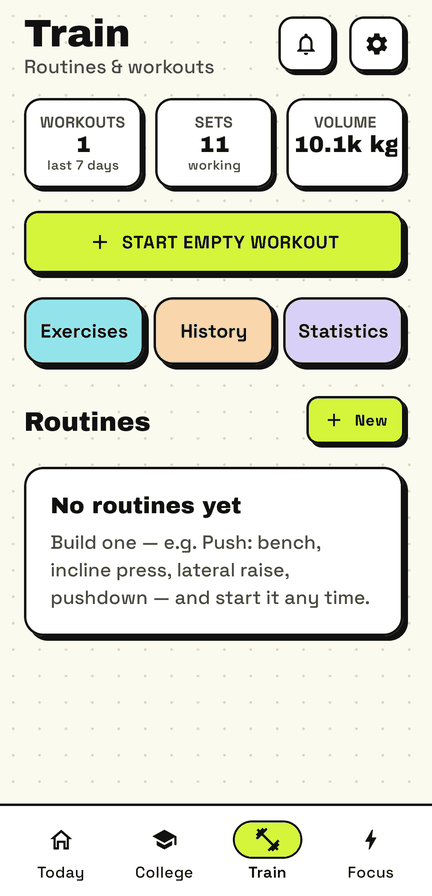
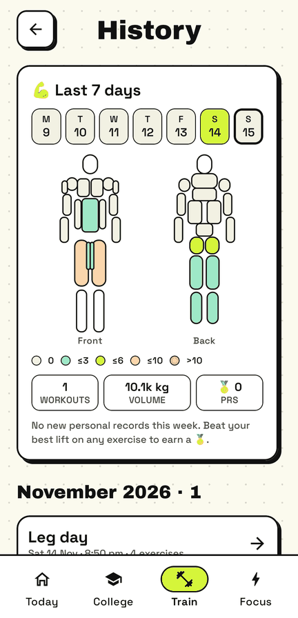
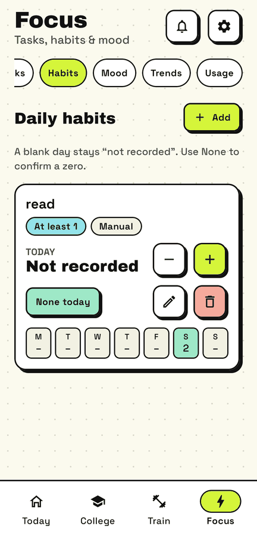
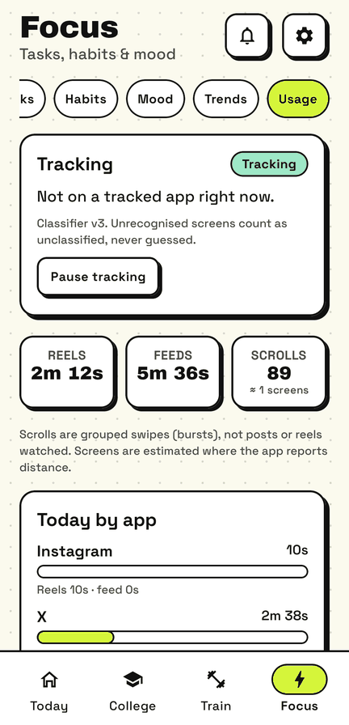
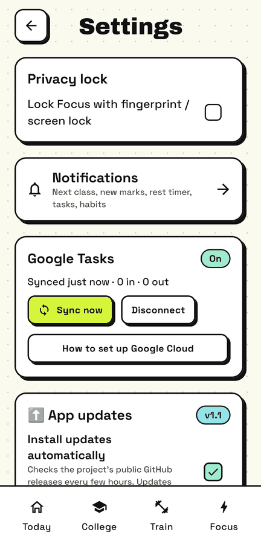

# HUB

**One app for a VIT student's day: classes, exams, marks, gym, tasks, habits and screen time.**

HUB is a free Android app that puts your college portal, your workouts and your daily focus
in one place. Everything lives on your phone. There are no accounts, ads or tracking, and
no server.

  
  
  

## Why HUB?

A normal day as a student means jumping between apps:

- **VTOP** for your timetable, attendance, marks and exam seats. It's slow, needs a login and
  CAPTCHA every time, and is awkward on a phone.
- **A gym tracker** for your workouts.
- **A to-do app**, **a habit tracker** and a **mood journal**.
- **Screen-time tools** that tell you how long you spent on Instagram, but not whether it went
  on Reels or on messages.

HUB brings all of these into one app. Your college data syncs from VTOP once and then works
offline. The **Today** screen tells you what matters right now: your next class, today's exam
and your seat, how much you've scrolled, and whether you've trained.

## Features

### Today: your day at a glance
- Six quick tiles: classes, tasks left, habits done, time scrolling today, workouts this
  week and your streak.
- A smart day card:
  - On a holiday, it says so and adds a random fun fact (there are 500 built in).
  - On an exam day, it says there are no classes and shows your paper and seat.
  - Otherwise it shows your next class. After 7 pm it shows tomorrow's first class.
- Your next exam with its seat number and room. The card moves on to the next paper once one
  is over.

### College (VTOP sync)
- Sign in to VTOP **inside the app, on your phone**. Your password is never stored or sent
  anywhere else.
- **Timetable**: your next class with its course code, room and slot.
- **Attendance**: a warning for every course below 75%.
- **Marks**: all your assessment scores.
- **Grade history**: GPA taken straight from VTOP, plus credits and grades for each course.
  Tap a course to see its score breakdown.
- **Exams**: seat number and row/column (for example R1C4) as bubbles you can read at a
  glance, plus the exam time and reporting time.
- **Academic calendar**: holidays, instructional days and exam days, colour-coded. Exam days
  show no classes.

  
  

### Train: gym tracker
- Start an empty workout or build routines. Log weight × reps for each set, with a rest
  timer.
- An exercise library with pictures for each exercise.
- **History** has two parts:
  - A body map of the muscles you worked in the last 7 days, with your weekly volume and
    personal records (PRs).
  - Compact workout cards. Tap one to see the full workout, then edit or delete it.
- **PRs**: beat your best lift on any exercise to earn a 🥇.
- **Statistics** for your progress over time.

  
  

### Focus: tasks, habits, mood and screen time
- **Tasks**, with optional two-way sync to **Google Tasks**.
- **Daily habits** with targets, a week strip, and a "None today" button so an empty day isn't
  mistaken for one you forgot to log.
- A **Mood** log and **Trends**.
- **Usage**: an optional screen-time tracker.
  - It splits time on apps such as Instagram and X into Reels/short-video time and feed time, and
    counts your scroll bursts.
  - It only counts how you use those apps. It never reads what is on your screen.
- An optional **privacy lock** that protects Focus with your fingerprint or screen lock.

  
  
  

### Notifications and updates
- Alerts you can turn on for:
  - Your next class: 10 minutes before it starts, or as soon as the current class ends.
  - New marks found on a sync. These also collect under the 🔔 bell, with an unread count.
  - Your gym rest timer.
  - Task and habit reminders.
- **Automatic updates**: HUB checks this repository's releases and installs new versions by
  itself, without asking every time. Your data and permissions stay as they are.
- **Backup and restore**: a daily backup on the phone, plus manual backups you can restore from.

## Install

1. Open the [latest release](https://github.com/Ace-9999/HUB/releases/latest) on your phone
   and download `HUB-vX.Y.apk`.
2. Open the downloaded file. If Android asks, allow your browser or file manager to install
   apps.
3. **Play Protect** may warn you, because the optional screen-time tracker uses an
   accessibility service. Tap **More details → Install anyway**.
4. Open HUB, go to **College** and sign in to VTOP to run your first sync.

You need Android 10 or newer. After this first install, updates arrive by themselves. You can
switch that off in **Settings → App updates**.

> **Optional extras**
> - **Screen-time tracking** needs you to turn on HUB in Android's accessibility settings. The
>   app shows you where.
> - **Google Tasks sync** needs a free Google Cloud client of your own. Tap
>   **Settings → Google Tasks → How to set up Google Cloud** for the steps.

## Privacy

- All data stays on your phone, in local databases.
- No analytics, no ads, no AI service and no backend.
- HUB only connects to the internet for three things:
  - **VTOP**, when you sync.
  - **Google Tasks**, only if you connect it.
  - **GitHub**, to check for updates.

## For developers

HUB is written in Kotlin with Jetpack Compose. It targets API 36 and runs on API 29 and
newer.

- Product spec: [SRS](PersonalHub_Plan/SRS.md). Progress and evidence:
  [project_progress.md](project_progress.md).
- Toolchain: JDK 21. To install the checkout-local Gradle and Android command-line tools, run
  `python scripts/bootstrap_toolchain.py`. Then install API 36, build-tools 35.0.0 and
  platform-tools, and set `sdk.dir` in `local.properties`.
- Build and test commands are in [docs/environment.md](docs/environment.md).
- This repository contains no credentials, signing keys or personal data.
